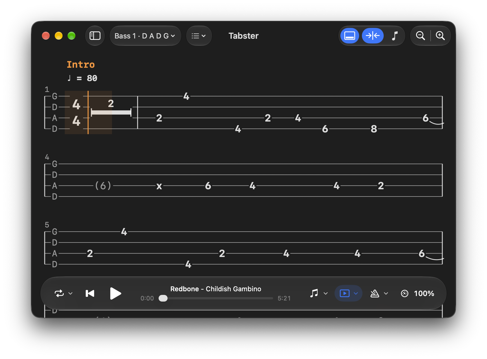

<div align="center">



# Tabster

Native macOS Guitar Pro tab player that plays along in sync with YouTube for audio.

[](https://github.com/jamieweavis/tabster/actions/workflows/build.yml)
[](https://github.com/jamieweavis/tabster/releases/latest)
[](https://github.com/jamieweavis/tabster/releases)


[**Download**](#download) · [Features](#features) · [Usage](#usage) · [Development](#development)

</div>

## Features

- **Your library**: import `.gp` (Guitar Pro 7/8), `.gpx` (Guitar Pro 6) and `.gp5` files or whole folders, then search, favourite, tag and group them into setlists
- **Watched folders**: point Tabster at a folder and new tabs are imported automatically
- **Practice tools**: loop, adjust the tempo, and use the metronome
- **YouTube sync**: attach any embeddable YouTube video to a tab and the cursor follows the recording
- **Tab audio**: no video? Hear the tab itself through a built-in General MIDI synth
- **Private by design**: no account and no cloud
- **Native and lightweight**: a Rust core with a SwiftUI shell, not a web view in a wrapper

### Syncing a video

Recordings rarely match the tab's tempo exactly, so Tabster gives you three ways to line them up:

| Method | Best for |
| --- | --- |
| **Offset** | Tap once on bar 1, then nudge. Good for studio recordings that keep to the click |
| **Offset + stretch** | Recordings that drift at a steady rate from the tab's tempo |
| **Per-bar sync points** | Live takes and anything with tempo changes. Tap along, drag markers, or import Guitar Pro 8 sync points |

## Download

Grab the latest build from the [**releases page**](https://github.com/jamieweavis/tabster/releases/latest):

| Platform | File |
| --- | --- |
| **macOS** (Apple Silicon, 26.0+) | `Tabster-<version>-macos-arm64.dmg` |

> [!NOTE]
> The app is ad-hoc signed but not notarised, so Gatekeeper will block it the first time. Right-click Tabster.app and choose **Open**, or run:
>
> ```sh
> xattr -dr com.apple.quarantine /Applications/Tabster.app
> ```

## Usage

1. Launch **Tabster** and drop some Guitar Pro files (or a folder of them) onto the library window, or use **File › Import** (⌘O).
2. Open a tab and press play to hear it through the built-in synth.
3. To play along with a recording, attach a YouTube video to the tab and sync it from the viewer.

Tabs are stored in `~/Library/Application Support/Tabster` and settings in `~/.config/tabster.toml`.

> [!IMPORTANT]
> Tabster doesn't download tabs for you: bring your own files. Respect the licences of the tabs and videos you use.

## Development

Requires macOS 26+, stable Rust via [rustup](https://rustup.rs), Xcode 26's command-line tools and [just](https://github.com/casey/just):

```sh
brew install just        # or: cargo install just
```

Then run `just` to list the recipes. The main ones:

```sh
just run                 # build the Rust core, Swift bindings and app, then launch build/Tabster.app
just test                # Rust tests
just test-swift          # Swift tests for the shell's pure logic
just check               # lint + all tests + app build (what CI runs)
just logs                # stream the app's logs
```

The first build downloads the [GeneralUser GS](https://github.com/mrbumpy409/GeneralUser-GS) SoundFont (~31 MB, SHA-256 verified; licence in [`Resources/Bundle/SOUNDFONT-LICENSE.txt`](Resources/Bundle/SOUNDFONT-LICENSE.txt)). The app is signed with "Apple Development" by default; set `TABSTER_SIGN_IDENTITY="-"` to sign ad hoc.

### Architecture

A Rust core ([`src/`](src)) does everything: parsing, the playback timeline, sync maths, layout, the library and the synth. It is exposed to a thin SwiftUI shell ([`shell/`](shell)) through [UniFFI](https://github.com/mozilla/uniffi-rs). The core even lays out the tab as a display list that the shell paints verbatim. See [CLAUDE.md](CLAUDE.md) for the details.

### Packaging

```sh
CONFIG=release just dmg  # build/Tabster-<version>-macos-arm64.dmg (+ .sha256)
```

Releases are automated with [release-plz](https://release-plz.dev): every push to `main` opens a release PR that bumps the version and updates `CHANGELOG.md` from the Conventional Commits. Merging it tags the release, and CI attaches the `.dmg` and publishes it.
